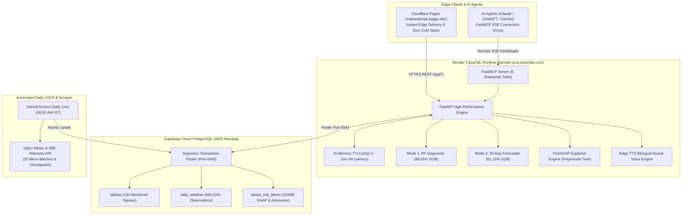

# MahaRainRisk (महाराष्ट्र पर्जन्य जोखीम)
### Maharashtra Taluka-Level Agritech Drought Early Warning & Farmer Advisory Platform

[](https://maharainrisk.pages.dev)
[](https://rainrisk-vcra.onrender.com/docs)
[](https://rainrisk-vcra.onrender.com/mcp)
[-informational?style=flat-square)]()
[]()
[]()
[](LICENSE)

> **MahaRainRisk** is an end-to-end data engineering, climatological modeling, and hyper-local farmer decision-support platform designed specifically for the **36 districts and 194 talukas of Maharashtra**.
> 
> • **Live Web Platform:** [https://maharainrisk.pages.dev](https://maharainrisk.pages.dev)  
> • **Backend API & Swagger:** [https://rainrisk-vcra.onrender.com/docs](https://rainrisk-vcra.onrender.com/docs)  
> • **AI Agent MCP Server:** [https://rainrisk-vcra.onrender.com/mcp](https://rainrisk-vcra.onrender.com/mcp)  
> 
> Features a **Liquid Glass Landing Page** with scroll-animated convergence that transitions directly into an **Obsidian-Emerald Agritech Dashboard**, combining real-time meteorological telemetry, dual-mode machine learning, TreeSHAP Explainable AI (XAI), 1-tap GPS centroid snapping, 12 major dam reservoirs, and official bilingual agrometeorological advisories in **Marathi (मराठी)** and **English**.

---

## 🌟 Key Features

1. **Multi-Tier Edge Architecture:**
   * **Cloudflare Pages Frontend:** Global edge delivery with $< 30\text{ ms}$ response times across India and zero-cost unlimited video streaming.
   * **Render FastAPI Backend:** High-performance asynchronous REST API with in-memory `TTLCache` (<2ms response) and live Supabase PostgreSQL (AWS Mumbai).
2. **Hyper-Local Resolution:**
   * Official Local Government Directory (LGD) taluka-level intelligence across all 6 administrative divisions (*Chhatrapati Sambhajinagar, Pune, Nashik, Amravati, Nagpur, and Konkan*).
3. **Dual-Mode Machine Learning:**
   * **Mode 1 (Diagnostic):** 250-Tree Random Forest Classifier (**99.05% OOB Accuracy**) identifying current drought risk severity.
   * **Mode 2 (Forecaster):** 30-Day Ahead Early Warning Forecaster (**81.12% OOB Accuracy**) predicting impending moisture failure.
4. **TreeSHAP Explainable AI (XAI):**
   * Polynomial-time instance-level feature attribution identifying Top 3 Risk Escalators and Top 1 Mitigating Buffer with natural Marathi/English narratives.
5. **Universal AI Agent Interoperability (FastMCP):**
   * Live remote MCP server exposing 6 typed agronomic tools over SSE for Claude Web, ChatGPT Web, and Google Gemini Web.
6. **4 State Agricultural University Advisories:**
   * **MPKV Rahuri** (Western Maharashtra & Scarcity Zone)
   * **VNMKV Parbhani** (Marathwada Division)
   * **Dr. PDKV Akola** (Vidarbha Division)
   * **Dr. BSKKV Dapoli** (Konkan Coastal Belt)
7. **Natural Neural Voice Advisories (Edge-TTS):**
   * Generates natural Marathi (`mr-IN-ManoharNeural`) and Indian English (`en-IN-PrabhatNeural`) voice advisories on demand.
8. **1-Tap Client-Side GPS Centroid Snapping:**
   * Zero-network Haversine algorithm matching farmer device GPS to the nearest monitored taluka in $< 0.4\text{ ms}$.

---

## 🏗️ System Architecture & Multi-Tier Cloud Topology



---

## 📂 Project Structure

```
MahaRainRisk/
├── backend/
│   ├── main.py                     # FastAPI application, CORS, lifespan & route definitions
│   ├── cache.py                    # Multi-tier TTLCache engine & pre-warming (<2ms)
│   ├── db.py                       # PostgreSQL connection pool & SQLi defense
│   ├── mcp_server.py               # FastMCP server exposing 6 enterprise AI tools
│   ├── schemas.py                  # Strict Pydantic V2 validation models
│   ├── services.py                 # Telemetry, inference, spatial adjacency & rollups
│   ├── tts_service.py              # Microsoft Edge neural speech engine (MR/EN)
│   └── test_api.py                 # Automated REST API test suite
├── frontend/
│   ├── index.html                  # Single-page web app (Landing + Dashboard + MCP Modal)
│   ├── css/                        # Modular glassmorphism stylesheets
│   │   ├── landing.css             # Liquid glass landing page styles
│   │   ├── variables.css           # Emerald & Obsidian theme tokens
│   │   ├── layout.css              # Main window & floating dock layout
│   │   ├── cards.css               # Farmer metric cards, TreeSHAP & contagion cards
│   │   └── modals.css              # Universal AI agent MCP connection modal
│   ├── js/                         # Frontend controllers
│   │   ├── app.js                  # 1-Tap Haversine GPS snapper & offline caching
│   │   ├── dashboard.js            # DOM updates, TreeSHAP cards & adjacent contagion radar
│   │   ├── map.js                  # Leaflet choropleth & GeoJSON layer
│   │   ├── state.js                # Global state & dynamic API_BASE switcher
│   │   ├── audio.js                # Neural audio player & voice search
│   │   └── i18n.js                 # English <-> Marathi language switcher
│   └── assets/                     # Leaflet assets, hero-monsoon.mp4, icons
├── ml/
│   ├── predict.py                  # Dual-mode production inference runtime
│   ├── xai_engine.py               # TreeSHAP explainer & bilingual narrative generator
│   ├── advisory_engine.py          # 4-University package of practices (MPKV, VNMKV, PDKV, BSKKV)
│   ├── train.py                    # Mode 1 Diagnostic model training pipeline
│   ├── train_forecaster.py         # Mode 2 30-Day Early Warning Forecaster pipeline
│   ├── drought_model.joblib        # 250-tree diagnostic classifier artifact (16 MB)
│   └── drought_forecaster.joblib   # 250-tree 30-day early warning forecaster (42 MB)
├── etl/
│   ├── daily_cron_ingestion.py     # 33 micro-batch live Open-Meteo ETL pipeline
│   └── seed_local_db.py            # High-speed binary COPY streaming seeder
├── db/
│   ├── supabase_schema.sql         # Supabase PostgreSQL DDL, GIN indexes & RLS policies
│   └── security_hardening.sql      # Least-privilege roles & row-level security
├── data/
│   ├── processed/
│   │   └── master_panel.parquet    # Production feature store (904 KB)
│   └── geo/
│       ├── lgd_maharashtra_master.csv  # 194 monitored talukas catalog
│       ├── taluka_adjacency.json       # Pre-computed spatial topology graph
│       └── maharashtra_districts.geojson # Simplified boundary polygons
├── tests/                          # 9-Phase Master Automated Verification Suites
│   ├── test_phase1_ml_and_validation.py
│   ├── test_phase2_db_security.py
│   ├── test_phase3_etl_pipeline.py
│   ├── test_phase4_caching.py
│   ├── test_phase5_render_production.py
│   ├── test_phase6_xai_explainer.py
│   ├── test_phase7_mcp_server.py
│   ├── test_phase8_frontend_integration.py
│   └── load_test.js                # Production Grafana k6 load test script
├── .github/workflows/
│   └── daily_ingest.yml            # Automated daily ingestion workflow (06:00 AM IST)
├── render.yaml                     # Render infrastructure-as-code cloud blueprint
├── Dockerfile                      # Hardened multi-stage container (non-root UID 1000)
├── requirements.txt                # Pinned production runtime dependencies
├── Procfile                        # PaaS web process definition
├── runtime.txt                     # Python version pin (3.13.0)
├── README.md                       # Master project documentation
├── UPGRADES_LOG.md                 # Forensic 9-Phase engineering audit log
├── MASTER_IMPLEMENTATION_ROADMAP.md # Architecture blueprint & dependency roadmap
└── MCP_CONNECTION_GUIDE.md         # Universal Claude/ChatGPT/Gemini MCP setup guide
```

---

## ⚡ Quickstart

### 1. Local Run
```bash
# Clone repository
git clone https://github.com/Rajratna-D/RainRisk.git
cd RainRisk

# Install production dependencies
pip install -r requirements.txt

# Run backend API server
uvicorn backend.main:app --host 0.0.0.0 --port 8000
```
Open `http://localhost:8000` to view the platform locally, or visit `/docs` for interactive Swagger API testing.

### 2. Run with Docker
```bash
docker build -t maharainrisk .
docker run -p 8000:8000 maharainrisk
```

---

## 📡 Live Production Endpoints Quick Reference

| Method | Endpoint | Description |
| :---: | :--- | :--- |
| `GET` | `/health` | Sub-5ms liveness probe confirming cache, models & database health |
| `GET` | `/api/talukas` | Full catalog of 194 monitored Maharashtra talukas for search & GPS |
| `GET` | `/api/taluka/{query}` | Live telemetry, dual ML predictions, 4 gauges & university advisories |
| `GET` | `/api/v1/taluka/{query}/explain` | **TreeSHAP Explainability:** Top 3 escalators, top buffer & Marathi narrative |
| `GET` | `/api/v1/taluka/{query}/adjacent` | **Spatial Topology:** Topological neighbors & regional contagion assessment |
| `GET` | `/api/district/{district}/summary` | Administrative district rollup & assigned reservoir storage % |
| `GET` | `/api/analytics/overview` | Macro state-wide summary, risk distribution & top 5 drought hotspots |
| `GET` | `/api/compare` | Head-to-head agronomic comparison between any two talukas |
| `GET` | `/api/map/geojson` | Taluka boundary polygons with dynamic risk color coding |
| `GET` | `/api/audio/advisory/{query}` | Natural bilingual Marathi/English neural speech audio stream |
| `GET` | `/mcp` *(or `/mcp/sse`)* | **Model Context Protocol (FastMCP):** Remote SSE stream for AI agents |
| `GET` | `/api/v1/cache/stats` | Observability endpoint returning in-memory TTLCache hit/miss ratios |

*Interactive Swagger documentation is available at [https://rainrisk-vcra.onrender.com/docs](https://rainrisk-vcra.onrender.com/docs).*

## 📜 Citation & License

This project is licensed under the MIT License. See [LICENSE](LICENSE) for details.

* Climatological data provided by the **India Meteorological Department (IMD)**.
* Agronomical advisories anchored to **MPKV Rahuri**, **VNMKV Parbhani**, **Dr. PDKV Akola**, and **Dr. BSKKV Dapoli**.
