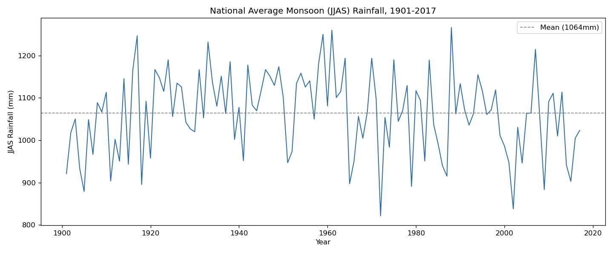
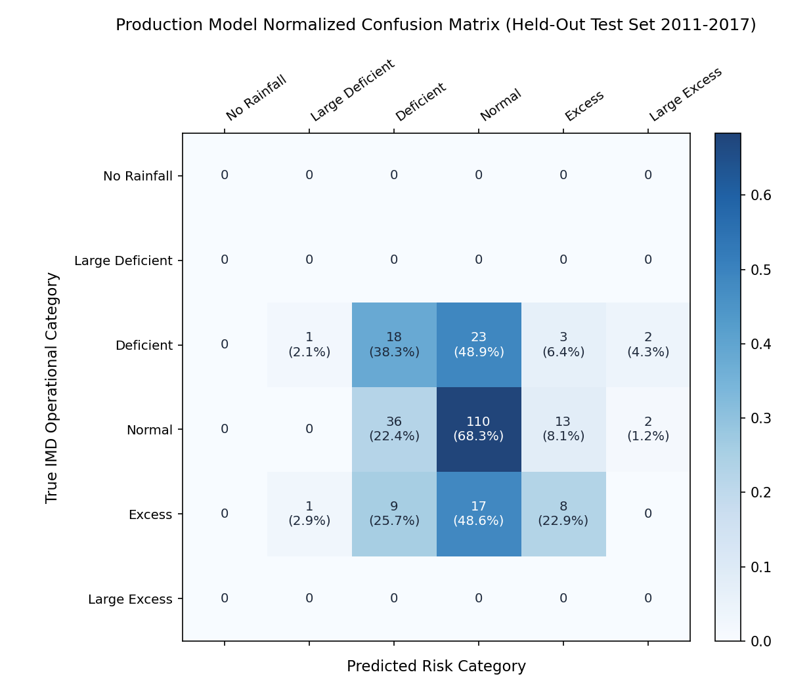
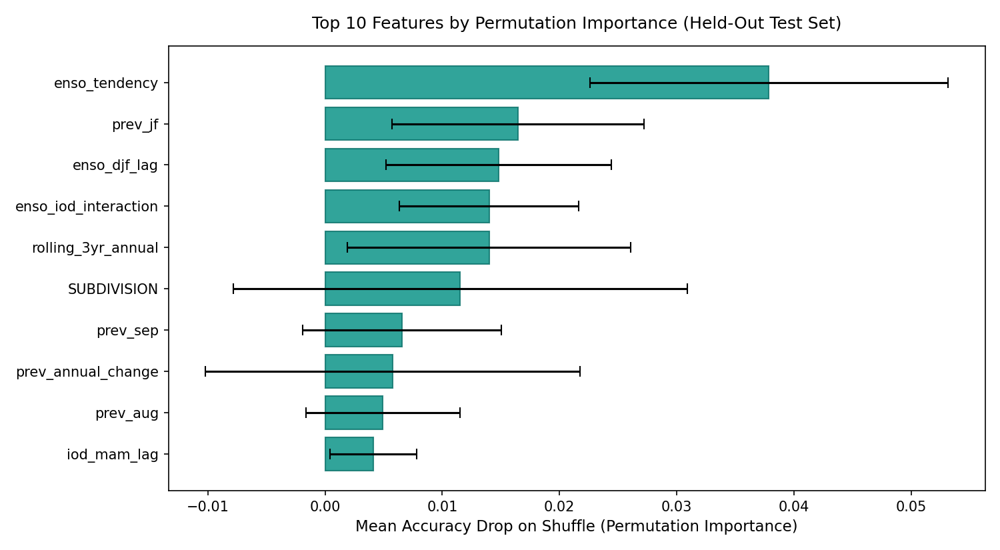
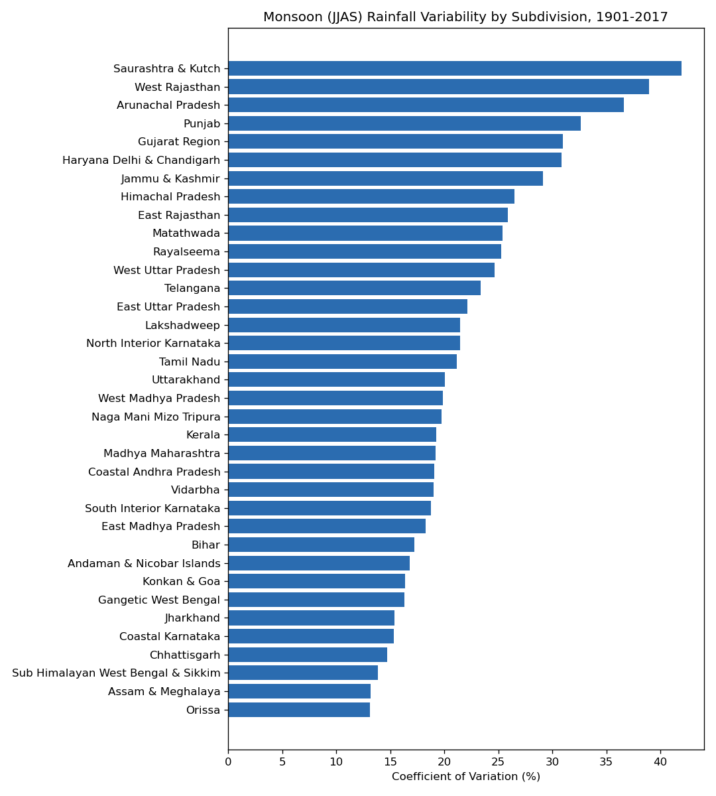

# RainRisk: AI-Powered Monsoon Drought and Rainfall Prediction for India

[](https://www.python.org/)
[](https://fastapi.tiangolo.com/)
[](https://react.dev/)
[](https://scikit-learn.org/)
[](https://docs.pytest.org/)
[-blue?style=flat-square)](https://mausam.imd.gov.in/)
[](LICENSE)
[](docs/RainRisk_Project_Report.pdf)
[](docs/UML_DIAGRAMS.md)

> **Predicting regional monsoon rainfall departures and meteorological drought risks across India before the rainy season begins — using 117 years of weather records, macro-climatic ocean temperatures, and ordinal machine learning.**

---

## Table of Contents
- [What is RainRisk?](#what-is-rainrisk)
- [Problem Statement](#problem-statement)
- [Results at a Glance](#results-at-a-glance)
- [Visual Analytics & Climatological Insights](#visual-analytics--climatological-insights)
- [How the AI Works](#how-the-ai-works)
- [The 23 Pre-Monsoon Features](#the-23-pre-monsoon-features)
- [12 Mistakes We Caught and Fixed (Audit Trail)](#12-mistakes-we-caught-and-fixed)
- [Actionable Agronomic Support (ICAR Contingency)](#actionable-agronomic-support-icar-contingency)
- [The Web Application & UI Experience](#the-web-application--ui-experience)
- [Quickstart: How to Run](#quickstart-how-to-run-it)
- [Project Structure](#project-structure)
- [Documentation & UML Architecture Index](#documentation-index)
- [Citation & License](#citation)

---

## What is RainRisk?

Every year between June and September, India receives over **70% of its annual rainfall** through the Southwest Monsoon. This seasonal deluge feeds rivers, fills reservoirs, and powers the summer farming season (Kharif), which accounts for **half of India's food production** and supports **600 million people**.

Because more than **55% of India's net sown area is strictly rainfed**, agricultural and water governance depends entirely on timely precipitation. A bad monsoon year triggers acute agrarian distress, depletion of drinking reservoirs, and macroeconomic shocks.

### Why National Forecasts Are Not Enough
Standard national forecasts issue a single macro-statistic for the whole country (e.g., *"India will receive 98% of normal rain"*). However, nationwide aggregates obscure extreme spatial variance:
- An overall "normal" year can still experience a **catastrophic drought in Rajasthan, Vidarbha, or Marathwada** while **Assam faces devastating floods**.
- Disaster management authorities, water resource managers, and farmers operate locally—they plan for specific meteorological zones and districts.

**RainRisk solves this.** It predicts whether each of India's **36 meteorological subdivisions** will face severe drought, deficient rain, normal rain, or excess precipitation, delivering that prediction **before June 1st** using only pre-season climate indicators.

---

## Problem Statement

### 1. The Real-World Challenge
Stakeholders require forecasts prior to June 1st. Once the monsoon arrives, it is too late to switch seed varieties, dig farm ponds, ration canal reservoirs, or establish emergency fodder camps. However, predicting regional precipitation months in advance across 36 topographically distinct zones is an open climatological challenge.

### 2. Why Conventional Machine Learning Fails
Standard off-the-shelf AI models fail on this task for three core reasons:

1. **Symmetric Loss vs Asymmetric Real-World Impact:**
   - Predicting **Normal** when the reality is **Deficient** (a 1-step error) is a manageable deviation.
   - Predicting **Excess / Flood** when the reality is **Severe Drought** (a 4-step error) is catastrophic. Standard classifiers penalize both errors equally. RainRisk implements **ordinal classification** (Frank & Hall decomposition) to heavily penalize distant, dangerous opposite-category errors.
2. **Extreme Class Imbalance:**
   - In India's 117-year climatological record, approximately **63% of years fall in the Normal category**, while severe droughts account for less than 1% of the data.
   - A naive model predicting "Normal" every time appears 63% accurate on paper but is practically useless because it never detects an incoming drought.
3. **Temporal Data Leakage (Lookahead Bias):**
   - Predictions intended for June 1st cannot incorporate June, July, or August rainfall data.
   - Standard randomized train/test splits quietly leak future temporal patterns into past training blocks. RainRisk strictly enforces forward-moving expanding-window chronological cross-validation.

### The Project Goal
> **Build a scientifically audited, leakage-free AI model that predicts regional rainfall categories for all 36 Indian subdivisions using only pre-June 1st data, successfully detects rare droughts, avoids disastrous opposite-category errors, and translates predictions into actionable contingency policies.**

---

## Results at a Glance

Evaluated on an untouched holdout test set of the most recent historical years (**2011 to 2017, covering 243 regional observations**):

| Model | Feature Set | Exact Hit Rate | Balanced Score (Across All Classes) | Off-by-One Accuracy (Within ±1 Class) | Average Error Distance | Training Time |
|---|---|:---:|:---:|:---:|:---:|:---:|
| **Random Forest (Production)** | **23 Features (Rain + Ocean)** | **56.0%** | **43.2%** | **93.0%** | **0.52 steps** | **1.7 sec** |
| Ordinal RF (Frank-Hall) | 23 Features (Rain + Ocean) | 50.2% | 41.0% | 92.2% | 0.59 steps | 4.8 sec |
| Gradient Boosting | 23 Features (Rain + Ocean) | 47.3% | 39.6% | 90.5% | 0.63 steps | 3.4 min |
| HistGradientBoosting | 23 Features (Rain + Ocean) | 45.7% | 39.8% | 92.6% | 0.62 steps | 3.4 sec |
| Support Vector Machine (SVM) | 23 Features (Rain + Ocean) | 43.6% | 38.7% | 88.5% | 0.70 steps | 2.5 sec |
| Logistic Regression | 23 Features (Rain + Ocean) | 35.4% | 35.6% | 83.1% | 0.84 steps | 0.7 sec |

### 3 Big Takeaways:
1. **93.0% Practical Reliability:** In 93 out of 100 predictions, the model gets the exact category right or is off by just one neighboring level. Catastrophic opposite-category errors (predicting flood during drought) occur in only **3.3% of tests**.
2. **Ocean Temperatures Provide an +8.5% Lift:** Using historical rainfall data alone capped balanced accuracy at 34.7%. Incorporating Pacific (ENSO) and Indian Ocean (IOD) sea surface temperatures boosted detection of rare droughts and floods by **8.5 percentage points** to **43.2%**.
3. **Pacific Warming Velocity is the #1 Signal:** The rate at which the equatorial Pacific warms from winter to spring (`enso_tendency`) is the single most decisive pre-monsoon feature driving Indian rainfall suppression.

---

## Visual Analytics & Climatological Insights

### 1. 117 Years of Indian Monsoon Rainfall (1901–2017)

*National June-to-September rainfall over 117 years. The dashed line marks the long-term average (LPA) of 1,064 mm, highlighting historical drought benchmarks including 1965, 1972, 1987, 2002, 2009, and 2014–2015.*

### 2. Confusion Matrix: Error Distribution Across Tiers

*True vs. predicted categories. Normal rainfall is correctly identified in 68% of cases. When misses occur, predictions fall into immediately adjacent classes (off-by-one), preventing dangerous extreme misclassifications.*

### 3. Which Clues Matter Most? (Permutation Feature Importance)

*Permutation importance proves that macro-climatic ocean temperature rates (`enso_tendency`) and winter Pacific anomalies (`enso_djf_lag`) exert the highest impact on model predictive power.*

### 4. Regional Volatility Across India

*Arid regions like Western Rajasthan exhibit low mean rainfall but high interannual swings (volatility > 35%), whereas Western Ghats subdivisions maintain high annual totals with steady predictability.*

---

## How the AI Works

### 1. The 6 Official IMD Categories
The India Meteorological Department defines regional seasonal precipitation through percentage departure from the 50-year Long Period Average (LPA, 1971–2020):

| Category | Departure Range | Meteorological Meaning |
|---|---|---|
| **No Rainfall** | Exactly -100% | Zero rain recorded all season |
| **Large Deficient** | -99% to -60% | Severe drought emergency |
| **Deficient** | -59% to -20% | Moderate drought deficit |
| **Normal** | -19% to +19% | Climatologically normal monsoon |
| **Excess** | +20% to +59% | Surplus monsoon precipitation |
| **Large Excess** | +60% and above | Extreme flood / deluge risk |

### 2. Ordinal Classification (Frank & Hall Method)
Rather than treating categories as unranked tokens, RainRisk decomposes the problem into 5 cumulative binary threshold classifiers:
1. $P(\text{Rainfall} > \text{No Rain})$
2. $P(\text{Rainfall} > \text{Large Deficient})$
3. $P(\text{Rainfall} > \text{Deficient})$
4. $P(\text{Rainfall} > \text{Normal})$
5. $P(\text{Rainfall} > \text{Excess})$

By subtracting adjacent cumulative probabilities, the model computes calibrated probabilities for each severity tier, mathematically penalizing distant prediction errors.

### 3. SMOTENC: Imbalance Resolution Without Spatial Artifacts
Because extreme droughts are rare, synthetic balancing is necessary. Traditional SMOTE creates synthetic points by linear interpolation, which in categorical features produces impossible fractional regions (e.g., "40% Kerala + 60% Punjab"). We implement **SMOTENC** (for Nominal and Continuous features) to keep subdivision identifiers 100% authentic.

### 4. Time-Aware Expanding-Window Validation
Standard randomized K-fold cross-validation leaks temporal patterns into the past. We implement a 4-fold expanding chronological window (training on 1901–1980, testing on 1981–1990; training on 1901–1990, testing on 1991–2000, etc.) ensuring all test evaluations reflect genuine future unseen conditions.

---

## The 23 Pre-Monsoon Features

Every feature is computed using information available **strictly prior to June 1st**:

* **Past Monsoon Rainfall (5 features):** Previous year's JJAS total, 2-year difference, 3-year rolling mean, 5-year rolling mean, and 5-year coefficient of variation (volatility).
* **Monthly & Winter/Spring Distribution (13 features):** Individual monthly rainfall figures, winter rain (Jan–Feb), spring rain (Mar–May), post-monsoon rain (Oct–Dec), and seasonal concentration ratios.
* **Pacific & Indian Ocean Teleconnections (5 features):**
  - `enso_djf_lag`: Winter Pacific SST anomaly (Niño 3.4).
  - `enso_mam_signal`: Spring Pacific SST anomaly.
  - `enso_tendency`: Rate of Pacific warming from winter to spring ($MAM - DJF$).
  - `iod_mam_lag`: Spring Indian Ocean Dipole Mode Index (DMI).
  - `enso_iod_interaction`: Combined interaction capturing positive IOD buffering against El Niño drought.

---

## 12 Mistakes We Caught and Fixed

Our project maintains a transparent, documented 12-point scientific methodology audit:

| # | Scientific Defect | Impact | Resolution |
|---|---|---|---|
| **1** | Standard SMOTE on region names | Synthesized fractional region artifacts | Switched to `SMOTENC` to maintain pure categorical strings |
| **2** | Baseline used modern 50-year LPA | Pre-1971 records referenced future baseline | Clarified retrospective anomaly classification benchmark |
| **3** | Omission of "No Rain" tier | Early schema used 5 classes, missing severe edge | Added official 6th IMD category ("No Rain") |
| **4** | Heuristic -90% cutoff for "No Rain" | Unverified threshold lacked meteorological basis | Aligned strictly with IMD operational bulletin (-100%) |
| **5** | Redundant class weights after SMOTENC | `class_weight='balanced'` distorted resampled counts | Proved redundancy mathematically and cleaned pipeline |
| **6** | Single train/test split tuning | Hyperparameters overfit specific decades | Enforced 4-fold expanding-window temporal CV |
| **7** | Gini importance bias for region names | Inflated nominal cardinality significance | Adopted permutation importance to identify ocean drivers |
| **8** | Missing island territory calendar years | Positional rolling windows bridged across gaps | Reindexed all subdivisions to continuous 117-yr calendar grid |
| **9** | Unpinned dependency versions | Library updates triggered model serialization bugs | Locked all package versions in `requirements.txt` |
| **10** | Risk of scientific regressions | Easy to reintroduce fixed bugs during refactoring | Built automated regression guards in `tests/test_regression_guards.py` |
| **11** | Limited 5-feature baseline | Ignored winter/spring precursor dynamics | Engineered 13 monthly/seasonal features (+4.3% accuracy) |
| **12** | Omission of ocean teleconnections | Models missed global macro-climate drivers | Integrated NOAA/JAMSTEC ocean SST features (+8.5% balanced lift) |

---

## Actionable Agronomic Support (ICAR Contingency)

RainRisk bridges climate forecasting and frontline decision-making by automatically mapping predictions to official **Indian Council of Agricultural Research (ICAR)** district contingency plans:

| Prediction | Advisory Level | Policy & Agronomic Action |
|---|---|---|
| **Large Deficient / No Rain** | **Emergency** | Substitute water-intensive crops with short-duration pulses (moong/urad); ration reservoir allocations; set up cattle fodder camps; fast-track PMFBY crop insurance. |
| **Deficient** | **Warning** | Delay sowing by 10–14 days; adopt ridge-and-furrow moisture conservation; split fertilizer applications; prep micro-irrigation systems. |
| **Normal** | **Standard** | Proceed with full-scale standard Kharif sowing (paddy, cotton, soybean); utilize standard basal fertilizer; harvest runoff into farm ponds. |
| **Excess / Large Excess** | **Surplus** | Clear drainage field ditches to prevent root waterlogging; monitor for fungal blight; prepare fields for early Rabi winter sowing. |

---

## The Web Application & UI Experience

RainRisk is deployed as a decoupled, production-grade application featuring a cinematic liquid-glass design system and asynchronous REST backend.

```
+-------------------------------------------------------------------------------+
|                            REACT 18 SINGLE-PAGE APP                           |
|  - Cinematic Ambient Video Landing Page (Full-bleed monsoon backdrop)         |
|  - Dynamic Scroll Convergence Glass Panels (4 Corner Convergence)             |
|  - Bi-directional Smooth View Transitions (Landing <-> Dashboard)             |
|  - 6 Dashboard Modules: Pulse | Radar | Cockpit | Explorer | Board | Docs      |
+---------------------------------------+---------------------------------------+
                                        | Asynchronous REST (JSON) + Hash Sync
                                        v
+-------------------------------------------------------------------------------+
|                             FASTAPI BACKEND ENGINE                            |
|  - Endpoints: /api/overview | /api/predict | /api/map | /api/subdivisions     |
|  - Security: HTTP Security Headers, Pydantic Bounds Validation, Rate Limiter  |
|  - Caching & ML Persistence via Joblib Pipelines                              |
+-------------------------------------------------------------------------------+
```

### Key Frontend & Interactive Features
1. **Cinematic Liquid-Glass Landing Page:**
   - Full-bleed ambient video background (`hero-monsoon.mp4`) showcasing natural Indian monsoon dynamics.
   - Minimalist hero with Outfit typography and heavy frosted-glass metric capsules (`93.0% Within ±1 Class`, `117 Yrs Records`, `23 Features`, `36 Regions`).
   - 4 liquid-glass cards that converge dynamically from screen corners as the user scrolls down:
     1. *Pre-Monsoon Intelligence*
     2. *Ordinal Precision*
     3. *Pacific + Indian Oceans*
     4. *Century-Scale Climate Memory*
   - Bi-directional smooth view transitions between landing page and dashboard.
2. **Geospatial Radar (Interactive Leaflet Map):**
   - Full interactive choropleth map of India divided into 36 subdivisions, color-coded by predicted departure tier. Click any subdivision to inspect historical rainfall distributions, model probabilities, and ICAR advisories.
3. **Climate Cockpit (Simulation Sandbox):**
   - Interactive sliders for Pacific Ocean ENSO anomalies and Indian Ocean Dipole (IOD) indices. Adjust ocean conditions in real time to simulate how warming Pacific waters alter regional Indian drought risks.
4. **Regional Explorer:**
   - Deep-dive interface providing 117-year historical timelines, drought frequency statistics, and rainfall volatility for any chosen subdivision.
5. **Model Leaderboard:**
   - Transparent, in-app comparative benchmarking of all evaluated models, accuracy tiers, and runtime metrics.
6. **Methodology & Documentation:**
   - Integrated research index detailing mathematical formulas, data sources, and literature traceability.

### Backend Hardening & API Security
* **HTTP Security Headers:** Integrated headers (`X-Content-Type-Options: nosniff`, `X-Frame-Options: DENY`, `Referrer-Policy: strict-origin-when-cross-origin`).
* **Pydantic Validation:** Comprehensive input parameter bounds checking (`year` between 1901 and 2100, `subdivision` existence, ENSO/IOD valid numerical ranges).
* **Rate Limiting:** Sliding-window rate limiter on computational endpoints to protect inference throughput.
* **Hash-Based Routing:** Seamless browser history and bookmark synchronization (`#radar`, `#cockpit`, `#explorer`, `#leaderboard`, `#methodology`).

---

## Quickstart: How to Run It

### 1. Set Up the Project
```bash
# Clone the repository
git clone https://github.com/Rajratna-D/RainRisk.git
cd RainRisk

# Create a virtual environment
python -m venv .venv

# Activate the virtual environment:
# On Windows:
.venv\Scripts\activate
# On Mac/Linux:
source .venv/bin/activate

# Install dependencies
pip install -r requirements.txt
```

### 2. Launch the Web Application (One Command)
```bash
python run_webapp.py
```
This automatically initializes the FastAPI backend, serves the pre-built React frontend bundle, and opens **http://localhost:8008** in your browser.

### 3. Run Automated Tests
```bash
pytest tests
```
All **61 automated tests pass (100% pass rate)**, verifying data labeling, feature engineering pipelines, ordinal math, API routes, and scientific regression guards.

---

## Project Structure

```
RainRisk/
├── backend/                       # FastAPI REST Backend Service
│   ├── main.py                    # API routes, rate limiting, security headers, ML inference
│   └── __init__.py
│
├── frontend/                      # React 18 + Vite Web Application
│   ├── public/
│   │   ├── hero-monsoon.mp4       # Full-bleed ambient landing page background video
│   │   └── hero-poster.jpg        # Video fallback poster for mobile viewports
│   ├── src/
│   │   ├── components/
│   │   │   ├── LandingPage.jsx    # Cinematic liquid-glass landing page with scroll convergence
│   │   │   ├── Navbar.jsx         # Navigation bar with bi-directional view transition
│   │   │   ├── ClimateCockpit.jsx # Simulation sandbox with interactive ocean sliders
│   │   │   ├── GeospatialRadar.jsx# 36-subdivision interactive Leaflet GIS map
│   │   │   ├── RegionalExplorer.jsx# 117-yr historical subdivision visualizer
│   │   │   ├── ModelLeaderboard.jsx# Algorithm comparison table
│   │   │   └── Methodology.jsx    # Embedded scientific and literature review guide
│   │   ├── App.jsx                # Root app state & routing logic
│   │   └── index.css              # Custom design system with glassmorphism & responsive layouts
│   ├── dist/                      # Pre-built production bundle (serves without Node.js)
│   └── package.json
│
├── data/
│   ├── raw/                       # 117 years of IMD subdivision rainfall records (1901–2017)
│   ├── interim/                   # Cleaned precipitation and NOAA/JAMSTEC teleconnection series
│   └── processed/                 # Final 23-feature model training matrix
│
├── src/                           # Core Machine Learning & Climatology Pipelines
│   ├── labeling.py                # Official IMD departure formulas & category definitions
│   ├── features.py                # 23 pre-monsoon features engineered without lookahead bias
│   ├── train.py                   # Model estimators, SMOTENC oversampling, and pipelines
│   ├── ordinal.py                 # Frank and Hall cumulative ordinal decomposition code
│   ├── evaluate.py                # Ordinal distance, off-by-one, and accuracy scoring
│   ├── temporal_cv.py             # Expanding-window chronological cross-validation folds
│   ├── tune.py                    # Time-series hyperparameter search
│   ├── advisory.py                # ICAR agricultural contingency advisory engine
│   └── save_model.py              # Serializes trained model pipelines
│
├── tests/                         # 61 Automated Pytest Suites (100% Passing)
│   ├── test_labeling.py           # Verification of 6 IMD categories and boundaries
│   ├── test_features.py           # Leakage prevention and feature computation tests
│   ├── test_ordinal.py            # Frank-Hall decomposition & probability constraints
│   ├── test_backend_api.py        # FastAPI endpoints, validation, and error handlers
│   └── test_regression_guards.py  # 12-point scientific methodology audit guards
│
├── results/
│   ├── figures/                   # Confusion matrices, feature importances, trend graphs
│   └── model/                     # Serialized production model weights (best_pipeline.joblib)
│
├── scripts/
│   └── fetch_teleconnections.py    # Downloads and processes NOAA Niño 3.4 & JAMSTEC DMI indices
│
├── docs/                          # Comprehensive Technical Documentation & Architecture
│   ├── RainRisk_Project_Report.pdf# Complete 22-page publication-grade report
│   ├── RainRisk_Project_Report.md # Full technical report (14,000+ words)
│   ├── UML_DIAGRAMS.md            # Complete UML specifications (Component, Sequence, Activity, etc.)
│   ├── diagrams/                  # Raw Mermaid architecture models (.mmd)
│   ├── 01_architecture.md         # System design, data flow, and API architecture
│   ├── 02_labeling_spec.md        # Mathematical departure formulas and IMD rules
│   ├── 03_modeling_spec.md        # Chronological validation, SMOTENC configurations, and metric definitions
│   ├── 04_lit_review_traceability.md # 25 scientific research papers mapped directly to implementation decisions
│   ├── 05_methodology_fixes.md    # 12-point scientific bug audit trail
│   ├── 06_dashboard_user_guide_and_spec.md # Operational walkthrough of all 6 interactive web platform modules
│   ├── 07_teleconnections_implementation_plan.md # Ocean-atmosphere mechanics (ENSO, IOD) and feature construction
│   ├── 08_frank_hall_ordinal_decomposition.md # Mathematical derivation of ordinal mechanics
│   └── 09_data_sources_catalog.md # Raw data provenance, links, and citations
│
├── requirements.txt               # Strict pinned Python dependencies
├── Dockerfile                     # Container deployment specification
├── Procfile                       # Process file for cloud deployment
├── render.yaml                    # Infrastructure-as-code cloud deployment manifest
└── run_webapp.py                  # One-click startup script for backend and UI
```

---

## Documentation Index

| Resource | Scope & Details |
|---|---|
| [UML Diagrams & Architecture](docs/UML_DIAGRAMS.md) | Component, Sequence, Use Case, Activity, State Machine, and Class diagrams |
| [RainRisk Project Report (PDF)](docs/RainRisk_Project_Report.pdf) | Complete 22-page publication-grade report with tables and figures |
| [RainRisk Project Report (Markdown)](docs/RainRisk_Project_Report.md) | Comprehensive 14,000+ word technical report spanning all 12 chapters |
| [01: System Architecture](docs/01_architecture.md) | Decoupled architecture, REST specification, and deployment topology |
| [02: Labeling Specification](docs/02_labeling_spec.md) | Formal IMD departure equations and class boundary verification |
| [03: Modeling Specification](docs/03_modeling_spec.md) | Chronological validation, SMOTENC configurations, and metric definitions |
| [04: Literature Review Traceability](docs/04_lit_review_traceability.md) | 25 scientific research papers mapped directly to implementation decisions |
| [05: Methodology Audit Trail](docs/05_methodology_fixes.md) | In-depth story of all 12 scientific corrections applied during research |
| [06: Dashboard Guide](docs/06_dashboard_user_guide_and_spec.md) | Operational walkthrough of all 6 interactive web platform modules |
| [07: Teleconnections Plan](docs/07_teleconnections_implementation_plan.md) | Ocean-atmosphere mechanics (ENSO, IOD) and feature construction |
| [08: Ordinal Decomposition](docs/08_frank_hall_ordinal_decomposition.md) | Mathematical formulation of Frank and Hall cumulative threshold models |
| [09: Data Sources Catalog](docs/09_data_sources_catalog.md) | Citations, access dates, and links for all raw climatological records |

---

## Citation

If you use RainRisk in your research, academic report, or application, please cite:

```bibtex
@software{rainrisk2026,
  author    = {Dhiwar, Rajratna},
  title     = {RainRisk: AI-Powered Monsoon Drought and Rainfall Prediction for India},
  year      = {2026},
  publisher = {GitHub},
  url       = {https://github.com/Rajratna-D/RainRisk}
}
```

---

## License

This project is licensed under the MIT License — see the [LICENSE](LICENSE) file for details.
