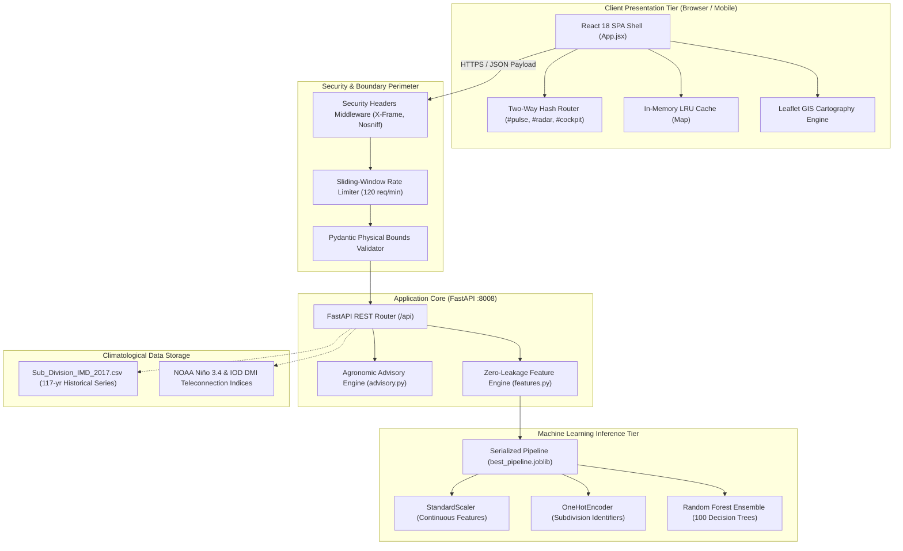
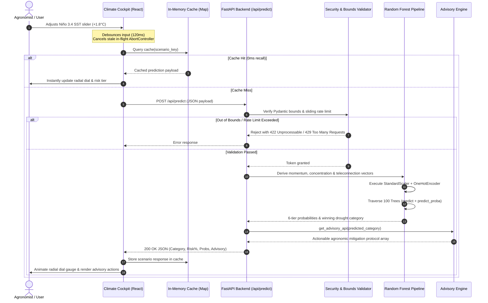
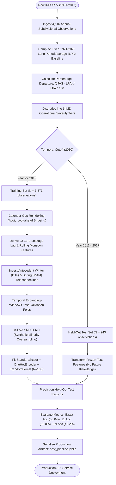
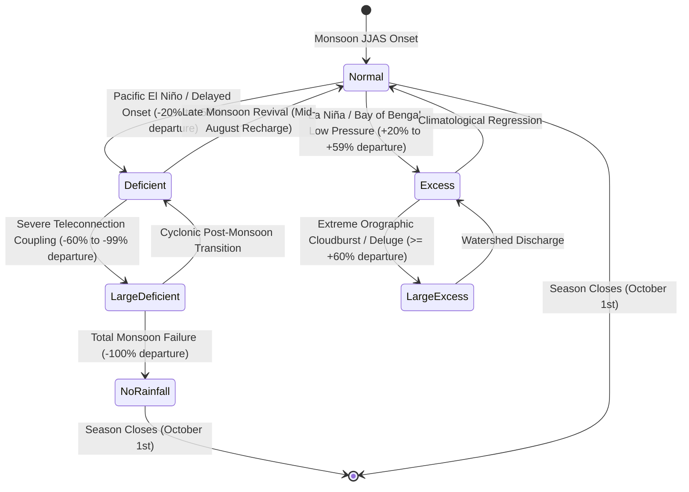
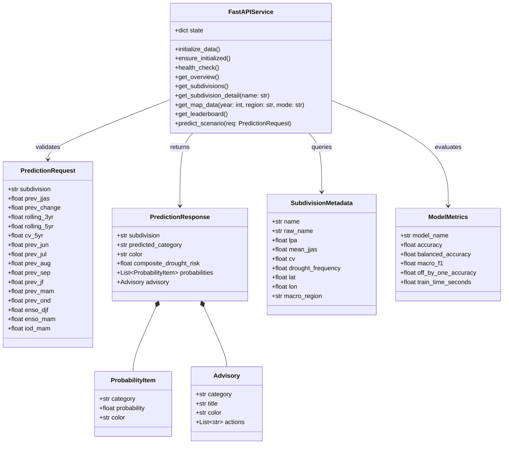

# RainRisk UML Diagrams & Architectural Specifications

This document defines the formal Unified Modeling Language (UML) specifications and system models for the **RainRisk** platform. These diagrams detail the system's structural components, runtime interactions, user workflows, data pipelines, and state transitions for academic reports, technical documentation, and presentation viva.

---

## Interactive Standalone Diagram Artifacts

For presentations, slides, and high-resolution exports (SVG / PNG / WebP), two interactive visualizers are available in this repository:
- **Component Architecture:** [rainrisk_architecture.html](file:///d:/PBL_selfmade/Rainrisk/docs/diagrams/rainrisk_architecture.html)
- **Sequence & Inference Lifecycle:** [rainrisk_sequence.html](file:///d:/PBL_selfmade/Rainrisk/docs/diagrams/rainrisk_sequence.html)

*(Open these `.html` files in any modern web browser to explore guided inspection views, toggle dark/light modes, trace message animations, or click **Export PNG/SVG**).*

---

## 1. System Architecture / UML Component Diagram

The Component Diagram models the software modules, communication boundaries, and execution environments spanning the client web layer, FastAPI backend, and Scikit-Learn machine learning pipeline.

### Component Details
1. **Client Presentation Tier (`frontend/`):** React 18 single-page application bundled with Vite. Contains 6 domain modules: Executive Pulse, Geospatial Radar, Regional Explorer, Model Benchmarks, Climate Cockpit, and Methodology.
2. **Security & Boundary Perimeter (`backend/main.py`):** Intercepts all traffic. Enforces defense-in-depth headers, sliding-window rate limiting (120 req/min per IP), and Pydantic physical bounds validation (`ge`, `le`).
3. **Application Core (`backend/main.py`, `src/advisory.py`):** Asynchronous FastAPI engine handling request routing, in-memory dataset caching, case-insensitive subdivision mapping, and dynamic agronomic advisory synthesis.
4. **ML Inference Tier (`src/train.py`, `results/model/`):** Scikit-Learn composite pipeline containing feature scaling, one-hot categorical encoding, and an ensemble of 100 Random Forest decision trees.
5. **Climatological Data Storage (`data/raw/`):** 117-year IMD continuous rainfall archive (1901–2017) paired with NOAA PSL Pacific Niño 3.4 and Indian Ocean Dipole (DMI) sea-surface temperature anomalies.

---

## 2. UML Sequence Diagram (Scenario Simulation & Predictive Inference)

The Sequence Diagram illustrates the runtime message exchanges and activation lifetimes between components during an interactive scenario simulation in the **Climate Cockpit**.

---

## 3. UML Use Case Diagram

The Use Case Diagram defines the primary actors who interact with the RainRisk platform and the operational capabilities provided to each role.

```mermaid
flowchart LR
    subgraph Actors
        Agri["Agricultural Officer / Agronomist"]
        Disaster["Disaster Management Authority (NDMA/SDMA)"]
        Researcher["Climate Researcher / Data Scientist"]
    end

    subgraph RainRiskPlatform["RainRisk Platform Boundary"]
        UC1(["UC-1: Monitor 117-Year National Monsoon Telemetry"])
        UC2(["UC-2: Track Sub-Divisional Drought Shocks on Geospatial Radar"])
        UC3(["UC-3: Benchmark Classification Models against Baselines"])
        UC4(["UC-4: Simulate Pacific/Indian Ocean SST Teleconnection Shocks"])
        UC5(["UC-5: Generate Crop Mitigation & Irrigation Advisories"])
        UC6(["UC-6: Compare Climatological Twin Subdivisions"])
    end

    Agri --> UC2
    Agri --> UC4
    Agri --> UC5
    Agri --> UC6

    Disaster --> UC1
    Disaster --> UC2
    Disaster --> UC4
    Disaster --> UC5

    Researcher --> UC1
    Researcher --> UC3
    Researcher --> UC4
```

### Use Case Specifications

| Use Case ID | Name | Primary Actor | Description |
|---|---|---|---|
| **UC-1** | Monitor National Telemetry | Disaster Authority | Review national LPA departures, 10-year smoothing curves, and landmark historical drought shocks. |
| **UC-2** | Track Geospatial Radar | Agronomist, Disaster Auth | Filter India's 36 subdivisions by drought/surplus severity and inspect historical or forecasted spatial bubbles. |
| **UC-3** | Benchmark Models | Researcher | Analyze confusion matrix diagonal agreement, balanced accuracy (43.2%), and off-by-one accuracy (93.0%). |
| **UC-4** | Simulate Teleconnections | Agronomist, Researcher | Drag Niño 3.4 and IOD DMI anomaly sliders to test physical Pacific-Indian Ocean coupled drought scenarios. |
| **UC-5** | Generate Advisory | Agronomist, Disaster Auth | Receive automated agronomic actions (contingency cropping, canal scheduling, micro-irrigation). |
| **UC-6** | Compare Twin Subdivisions | Agronomist | Compare precipitation distribution, monthly means, and decadal regime shifts between two chosen subdivisions. |

---

## 4. UML Activity / ML Data Pipeline Diagram

The Activity Diagram traces the end-to-end data lifecycle from raw IMD observational ingestion through zero-leakage feature engineering, synthetic resampling, and pipeline serialization.

---

## 5. UML State Machine Diagram (Monsoon Anomaly & IMD Drought Severity)

The State Machine Diagram documents the physical states of a meteorological subdivision based on the operational classification criteria defined by the India Meteorological Department (IMD).

### State Transition Truth Table

| State Name | Departure Range | Meteorological Significance | Agronomic Advisory Trigger |
|---|---|---|---|
| **No Rainfall** | `= -100%` | Complete monsoon collapse | Emergency groundwater rationing; national relief mobilization. |
| **Large Deficient** | `-99% to -60%` | Severe drought disaster | Shift to ultra-short duration contingency crops; fodder banks. |
| **Deficient** | `-59% to -20%` | Moderate drought condition | Supplemental drip/sprinkler scheduling; canal tail-end prioritization. |
| **Normal** | `-19% to +19%` | Climatologically optimal | Standard high-yield sowing; baseline fertigation schedule. |
| **Excess** | `+20% to +59%` | Significant surplus | Drainage network activation; moisture-retention soil planning. |
| **Large Excess** | `>= +60%` | Severe deluge / flood threat | Flood barrier evacuation; root-rot and fungal pesticide protocols. |

---

## 6. UML Class Diagram (Domain Model & Pydantic Contracts)

The Class Diagram illustrates the structural entities, data attributes, type constraints, and methods governing the FastAPI backend service.

---

## 7. How to Export and Embed These Diagrams

1. **For Word, PDF, or IEEE Papers:**
   - Open [rainrisk_architecture.html](file:///d:/PBL_selfmade/Rainrisk/docs/diagrams/rainrisk_architecture.html) or [rainrisk_sequence.html](file:///d:/PBL_selfmade/Rainrisk/docs/diagrams/rainrisk_sequence.html) in your browser.
   - Click the **Export PNG** button in the viewer menu. The image is generated at 300 DPI vector clarity with transparent or themed backgrounds.
2. **For GitHub & Markdown Documentation:**
   - The Mermaid diagrams in this file automatically render interactively across GitHub repositories, GitHub Pages, and VS Code Markdown Preview.
3. **For Editable Vector Diagrams (Draw.io):**
   - Copy any Mermaid code block above.
   - Open [Draw.io](https://app.diagrams.net), go to `Arrange` ➔ `Insert` ➔ `Advanced` ➔ `Mermaid`, paste the snippet, and export as SVG or PDF.
